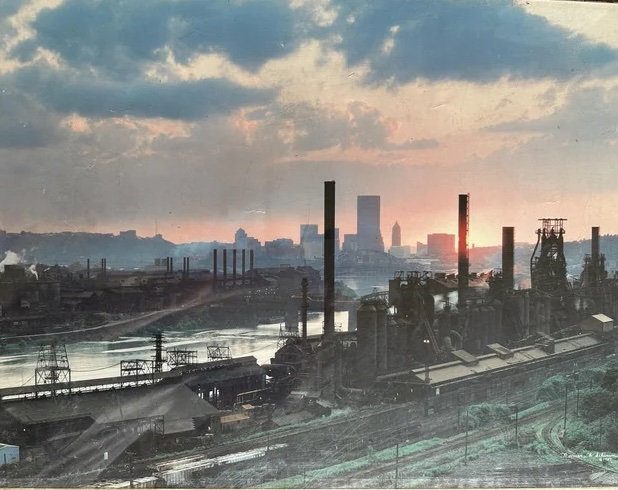
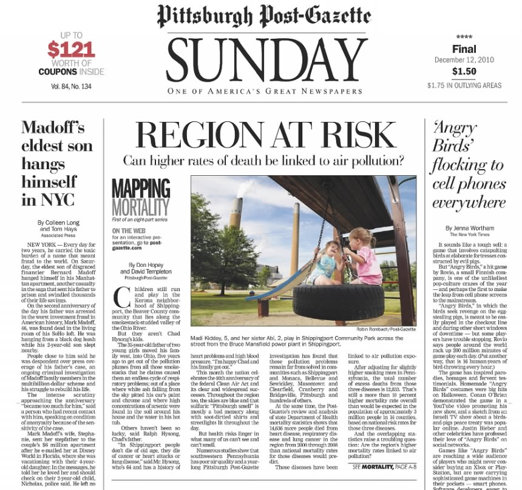
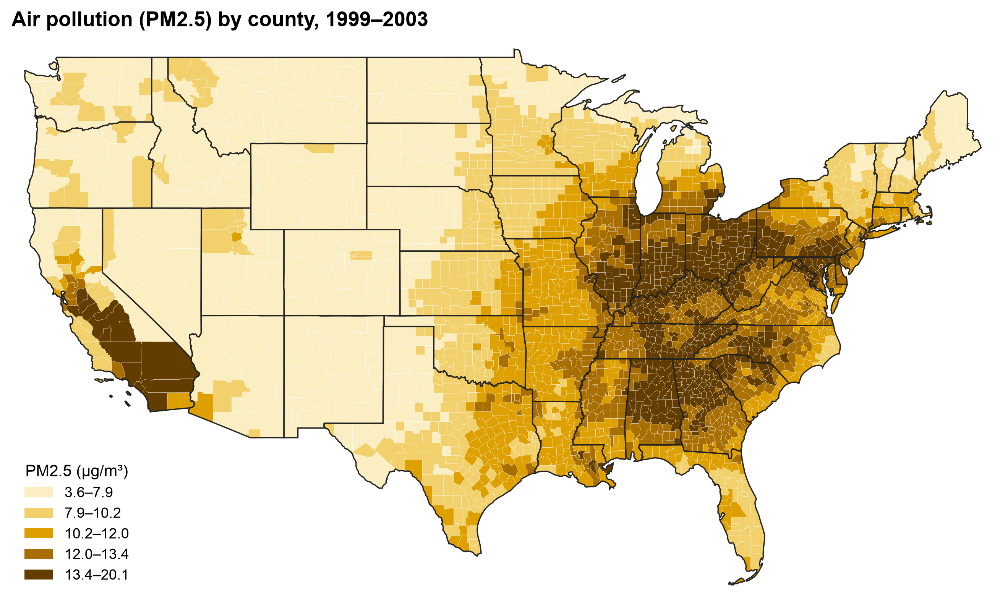
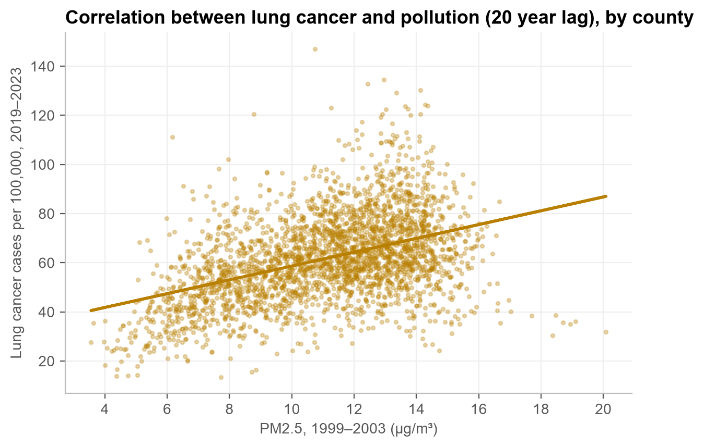

```{=html}

<style>
  /* Fonts: Source Serif 4 for reading, Libre Franklin for headings */
  @import url('https://fonts.googleapis.com/css2?family=Libre+Franklin:wght@400;600;800&family=Source+Serif+4:opsz,wght@8..60,400;8..60,600&display=swap');
  body, p, .narrative { font-family: 'Source Serif 4', Georgia, serif; }
  h1, h2, h3, .big-title h1 { font-family: 'Libre Franklin', Arial, sans-serif; }

  /* Opening photo section */
  .intro-photo img { width: 100vw; height: 100vh; max-width: none; object-fit: cover; object-position: center 15%; }
  .intro-photo.faded img { opacity: 0.3; }
  .intro .narrative p, .intro .narrative-col p {
    font-size: 1.5rem; line-height: 1.4; font-weight: 500;
  }
  .intro.cr-section .narrative-col .trigger { padding-block: 2svh; }
  .intro.cr-section .narrative-col .trigger:first-child { padding-block: 50svh 50svh; }

  /* Title */
  /* Title: big, tight spacing, and the smoke effect */
  .big-title h1, h1.big-title { font-size: clamp(3.5rem, 10vw, 8.5rem); line-height: 0.95; font-weight: 800; letter-spacing: -0.03em; text-align: center; margin-top: 45vh; margin-bottom: 1.5rem; }
  .smoke-word { display: inline-block; white-space: nowrap; }
  .smoke-letter { display: inline-block; opacity: 0; filter: blur(14px); transform: translateY(0.3em) scale(1.15); }
  .materialize .smoke-letter { animation: smoke-in 1.4s ease-out forwards; }
  @keyframes smoke-in {
    0%   { opacity: 0;   filter: blur(14px); transform: translateY(0.3em) scale(1.15); }
    60%  { opacity: 0.7; filter: blur(3px); }
    100% { opacity: 1;   filter: blur(0);    transform: none; }
  }
  @media (prefers-reduced-motion: reduce) {
    .smoke-letter { opacity: 1; filter: none; transform: none; }
    .materialize .smoke-letter { animation: none; }
  }
  .dek { font-family: 'Source Serif 4', Georgia, serif; font-size: 1.4rem; line-height: 1.45; color: #444; text-align: center; max-width: 640px; margin: 0 auto 1rem; }
  .byline { font-family: 'Libre Franklin', Arial, sans-serif; font-size: 0.85rem; letter-spacing: 0.05em; text-transform: uppercase; color: #777; text-align: center; margin-bottom: 8vh; }

  /* Section headings between parts of the story */
  .section-head h2, h2.section-head { font-family: 'Libre Franklin', Arial, sans-serif; font-size: clamp(1.6rem, 3vw, 2.4rem); font-weight: 800; line-height: 1.15; letter-spacing: -0.01em; text-align: center; max-width: 820px; margin: 4vh auto 6vh;  position: relative; z-index: 5; border-bottom: none;}

  /* Story paragraphs in the scrolling sections */
  .cr-section:not(.intro) .narrative-col .trigger { padding-block: 1.5svh; }
  .cr-section:not(.intro) .narrative { font-size: 1.2rem; line-height: 1.55; }
  .cr-section:not(.intro) .sticky img { width: 100% !important; }

    /* Pittsburgh photos: pin to the top instead of the middle */
  .cr-section.pgh .sticky-col .sticky-col-stack { padding-top: 12vh; }
  .cr-section.pgh .sticky-col .sticky-col-stack .sticky { margin: 0 auto auto auto; }

  /* Pittsburgh: draw the text higher so it lines up with the photo */
  .cr-section.pgh .narrative-col .trigger .narrative { transform: translateY(-40vh); }
  .cr-section.pgh .narrative-col .trigger:first-child { padding-top: 42vh; }
  .cr-section.pgh .narrative-col { margin-bottom: -40vh; background-color: transparent; }

  /* Pittsburgh photos: every photo fills the same 3:2 frame */
  [id^="cr-pgh"] { width: 100%; aspect-ratio: 3 / 2; overflow: hidden; }
  [id^="cr-pgh"] p, [id^="cr-pgh"] figure, [id^="cr-pgh"] .quarto-figure { height: 100%; margin: 0; }
  [id^="cr-pgh"] img { width: 100% !important; height: 100% !important; object-fit: cover; }

  /* Plain text between scrolling sections */
  .wide-text p { font-size: 1.2rem; line-height: 1.6; margin-bottom: 1em; }

  /* Newspaper article */
  #cr-article, #cr-excerpt { width: 100%; }
  #cr-article img, #cr-excerpt img { width: 100% !important; }
</style>

<script>
document.addEventListener("DOMContentLoaded", function () {
  const title = document.querySelector("h1.big-title, .big-title h1");
  if (!title) return;

  // Wrap each letter in its own span so the letters can appear one at a time
  const words = title.textContent.trim().split(" ");
  title.innerHTML = "";
  let n = 0;
  words.forEach(function (word, w) {
    const wordSpan = document.createElement("span");
    wordSpan.className = "smoke-word";
    for (const letter of word) {
      const s = document.createElement("span");
      s.className = "smoke-letter";
      s.textContent = letter;
      s.style.animationDelay = (n * 0.07) + "s";   // each letter starts 0.07 seconds after the one before
      wordSpan.appendChild(s);
      n++;
    }
    title.appendChild(wordSpan);
    if (w < words.length - 1) title.appendChild(document.createTextNode(" "));
  });

  // Start the animation when the title scrolls into view
  new IntersectionObserver(function (entries, observer) {
    if (entries[0].isIntersecting) {
      title.classList.add("materialize");
      observer.disconnect();
    }
  }, { threshold: 0.4 }).observe(title);
});
</script>

```

:::{.cr-section .intro .cr-column-screen layout="overlay-center"}

&nbsp; @cr-photo

My parents, Barney and Susie Guttman, were both diagnosed with lung cancer in their 80s. @cr-photo-faded

My mother's surgery was successful. My father had immunotherapy, chemotherapy, and radiation. Nothing worked, and he died nine months after his iniitial diagnosis. @cr-photo-faded

Strangely, several of my parents' friends were diagnosed with lung cancer around the same time. Was there a common denominator? They were all born and raised in Pittsburgh, starting in the 1940s. I started to wonder whether Pittsburgh's industrial pollution was to blame. @cr-photo-faded

:::{#cr-photo .intro-photo}

:::

:::{#cr-photo-faded .intro-photo .faded}

:::

:::

# Something in the Air {.unnumbered .big-title}

:::{.dek}
My parents never smoked, yet both got lung cancer. I went looking for answers in the air of the city where they grew up.
:::

:::{.byline}
By Harley Ungar · December 2026
:::

:::{.cr-section .pgh}

For more than a century, Pittsburgh was known as the Smoky City. Coal-fired mills, railroads and home furnaces filled the air so thickly that streetlights burned at midday. @cr-pgh1

That began to change after World War II. A smoke-control law passed in 1941 and was finally enforced in 1946. Within a decade, visible smoke had dropped dramatically.  @cr-pgh2

A quarter century later, the steel industry collapsed. Between the late 1970s and mid-1980s, the region lost tens of thousands of mill jobs, a devastating blow to the economy, though one that further cleared the air. @cr-pgh3

By the early 1990s, Pittsburgh’s skies looked much cleaner. But the fine-particle pollution you can’t see took longer to clear. When the CDC began tracking PM2.5 around 2000, Pittsburgh’s levels were still among the highest in the country. By then, many of the city’s older residents had been breathing polluted air for decades. @cr-pgh4

:::{#cr-pgh1}

:::

:::{#cr-pgh2}

:::

:::{#cr-pgh3}

:::

:::{#cr-pgh4}

:::

:::

## I wasn't the first person to wonder about the pollution–cancer connection {.section-head .unnumbered}

:::{.cr-section}

In December 2010, the Pittsburgh Post-Gazette ran an eight-part series called "Mapping Mortality: A Special Report on the Air We Breathe." Reporters Don Hopey and David Templeton spent a year analyzing 2000–2008 death rates from heart disease, lung disease and lung cancer across 14 counties in western Pennsylvania. [@cr-article]{scale-by="3" pan-to="-70%,-129%"}

With the help of local statisticians and public health experts, they concluded that cancer and heart disease rates in the Pittsburgh area were higher than would be expected based on national risk rates for these diseases. [@cr-article]{scale-by="3" pan-to="-70%,-129%"}

:::{#cr-article}

:::

:::

## Fifteen years after the newspaper's acclaimed series, I decided to revisit the analysis. {.section-head .unnumbered}

:::{.cr-section}
Rather than narrowly retracing Hopey and Templeton's journalistic steps, I chose to widen the lens. Instead of studying 14 counties in western Pennsylvania, I wanted to look at the entire country. [@cr-cancermap]{scale-by="3" pan-to="-80%,35%"}

First, I needed to know where lung cancer strikes most often today. The National Cancer Institute and the CDC track new cases in nearly every county in America. I pulled their numbers for 2019 to 2023, looking at how many people out of every 100,000 were diagnosed each year. I came up with a recent, annual, normalized average for each county in the U.S.  @cr-cancermap

Then came the air. Lung cancer doesn't appear overnight; it can take decades to develop. So rather than looking at today's air quality, I went back 20 years. Using estimates from the Center for Air, Climate, and Energy Solutions (CACES), I found out how much fine-particle pollution, known as PM2.5, residents of each county were breathing between 1999 and 2003. That became my annual average measure of air quality. CACES only covers the continental U.S. (excluding Alaska and Hawaii), so I was able to obtain data for 3,109 counties. @cr-pollutionmap

:::{#cr-cancermap}

:::

:::{#cr-pollutionmap}

:::

:::

:::{.cr-section}

So, were air pollution and lung cancer positively correlated? @cr-scatter

The scatterplot places each of the roughly 2,800 counties in the lower 48 states by two measures: its average PM2.5 concentration from 1999 to 2003 on the horizontal axis, and its age-adjusted lung cancer rate from 2019 to 2023 on the vertical axis. @cr-scatter

Start in the lower left. Counties that breathed the cleanest air around 2000 mostly have low lung cancer rates today, clustering between about 20 and 60 cases per 100,000. [@cr-scatter]{scale-by="2" pan-to="40%,-30%"}

Follow the best-fit line up and to the right, and the picture changes. Counties with dirtier air tend to have higher cancer rates. That upward drift is the signature of a positive correlation. [@cr-scatter]{scale-by="2" pan-to="-40%,30%"}

How strong is it? The correlation coefficient (r) is 0.43, on a scale where 0 means no relationship and 1 means a perfect one. That's a moderate correlation: real, but far from airtight. @cr-scatter

:::{#cr-scatter}

:::

::::