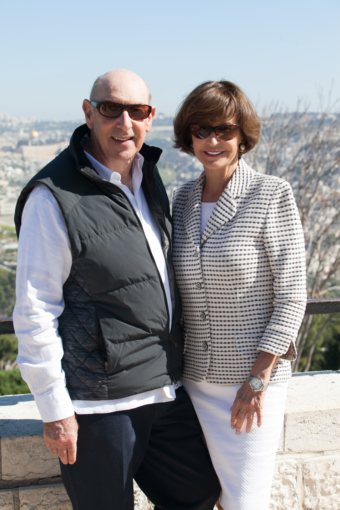
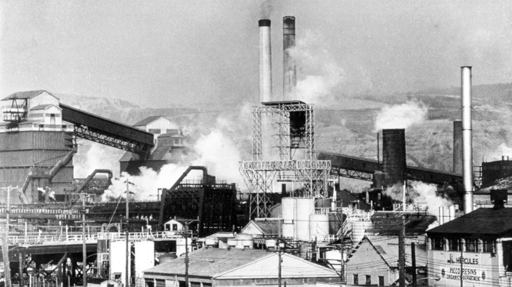

```{=html}

<style>
  .intro-photo img { width: 100vw; height: 100vh; max-width: none; object-fit: cover; object-position: center 15%; }
  .intro-photo.faded img { opacity: 0.3; }
  .intro .narrative p, .intro .narrative-col p {
    font-size: 2rem; line-height: 1.35; font-weight: 500;
  }
  .intro.cr-section .narrative-col .trigger { padding-block: 4svh; }
  .intro.cr-section .narrative-col .trigger:first-child { padding-block: 45svh 80svh; }
  .big-title h1, h1.big-title { font-size: 5rem; font-weight: 700; text-align: center; margin-top: 60vh; margin-bottom: 20vh; }
  .cr-section:not(.intro) .narrative-col .trigger { padding-block: 3svh; }
  .cr-section:not(.intro) .narrative { font-size: 1.45rem; line-height: 1.5; }
  .cr-section:not(.intro) .sticky img { width: 100% !important; }
    [id^="cr-pgh"] { width: 100%; }
  [id^="cr-pgh"] img { width: 100% !important; aspect-ratio: 3 / 2; object-fit: cover; }
  .wide-text p { font-size: 1.45rem; line-height: 1.6; margin-bottom: 1.2em; }
  #cr-article, #cr-excerpt { width: 100%; }
  #cr-article img, #cr-excerpt img { width: 100% !important; }
</style>
```

:::{.cr-section .intro .cr-column-screen layout="overlay-center"}

&nbsp; @cr-photo

My parents, Barney and Susie Guttman, were both diagnosed with lung cancer in their 80s. @cr-photo-faded

My mother had surgery to remove the tumors, and it was successful. My father went through a series of immunotherapy, then chemotherapy, then radiation. Nothing worked, and he died nine months after his iniitial diagnosis. @cr-photo-faded

Strangely, within several years, a couple of their friends were diagnosed with lung cancer as well. My parents and their friends had no histories of lung cancer in their families. Nor did any of them smoke. @cr-photo-faded

What they shared was a city. They were all born in Pittsburgh, and they lived there in the 1950s, 60s and 70s, when the steel mills and coal mines were still going strong. @cr-photo-faded

I started to wonder whether Pittsburgh's industrial pollution played a role in their developing cancer. @cr-photo-faded

:::{#cr-photo .intro-photo}

:::

:::{#cr-photo-faded .intro-photo .faded}

:::

:::

# Something in the Air {.unnumbered .big-title}

:::{.cr-section}

For more than a century, Pittsburgh was known as the Smoky City. Coal-fired mills, railroads and home furnaces filled the air so thickly that streetlights burned at midday. @cr-pgh1

That began to change after World War II. A smoke-control law passed in 1941 and was finally enforced in 1946. Within a decade, visible smoke had dropped dramatically.  @cr-pgh2

A quarter century later, the steel industry collapsed. Between the late 1970s and mid-1980s, the region lost tens of thousands of mill jobs, a devastating blow to the economy, though one that further cleared the air. @cr-pgh3

By the early 1990s, Pittsburgh’s skies looked much cleaner. But the fine-particle pollution you can’t see took longer to clear. When the CDC began tracking PM2.5 around 2000, Pittsburgh’s levels were still among the highest in the country. By then, many of the city’s older residents had been breathing polluted air for decades.@cr-pgh4

:::{#cr-pgh1}
{width="90%" fig-align="center"}
:::

:::{#cr-pgh2}
{width="90%" fig-align="center"}
:::

:::{#cr-pgh3}
{width="90%" fig-align="center"}
:::

:::{#cr-pgh4}
{width="90%" fig-align="center"}
:::

:::

:::{.cr-section}

In December 2010, the Pittsburgh Post-Gazette ran an eight-part series called "Mapping Mortality: A Special Report on the Air We Breathe." @cr-article

Reporters Don Hopey and David Templeton spent a year analyzing 2000–2008 death rates from heart disease, lung disease and lung cancer across 14 counties in western Pennsylvania. [@cr-article]{scale-by="3" pan-to="-70%,-129%"}

With the help of local statisticians and public health experts, they concluded that cancer and heart disease rates in the Pittsburgh area were higher than would be expected based on national risk rates for these diseases. [@cr-article]{scale-by="3" pan-to="-70%,-129%"}

:::{#cr-article}

:::

:::

Using slightly different data sets and geographic ranges, I decided to retrace the basic analytical steps that Hopey and Templeton took fifteen years ago. To begin, I pulled data from the State Cancer Profiles database compiled by the National Cancer Institute and the CDC: the average annual number of new lung cancer cases per 100,000 people between 2019 and 2023 for each county in the country. Then, I went to the CACES, the Center for Air, Climate, and Energy Solutions,recognizing the latency period for cancer to develop in response to environmental factors, I looked at average PM2.5 concentrations 