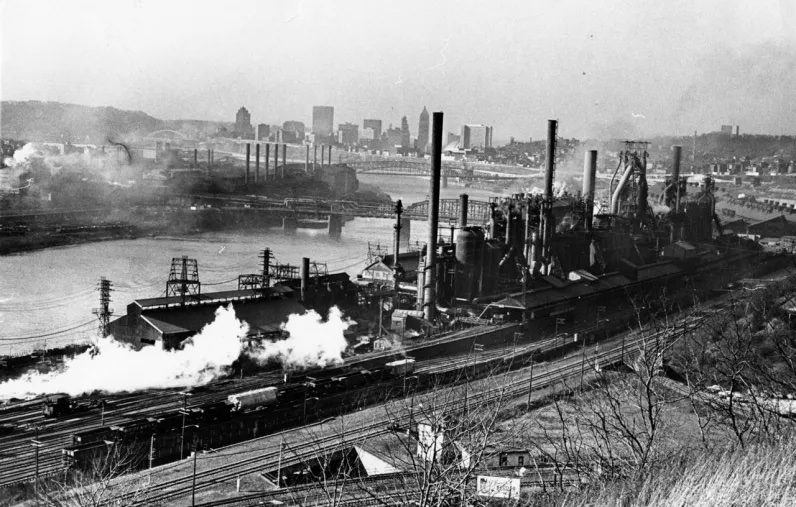
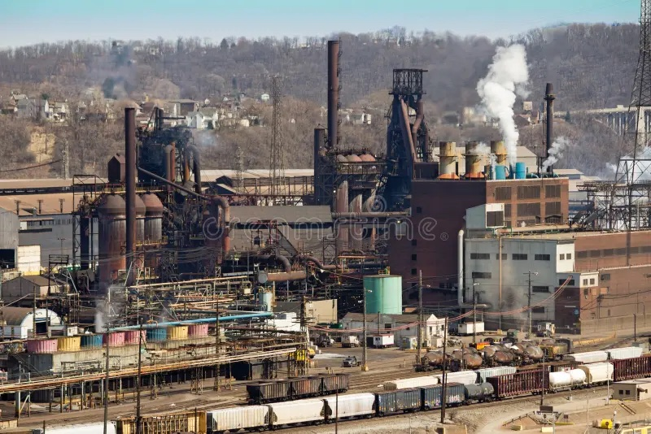
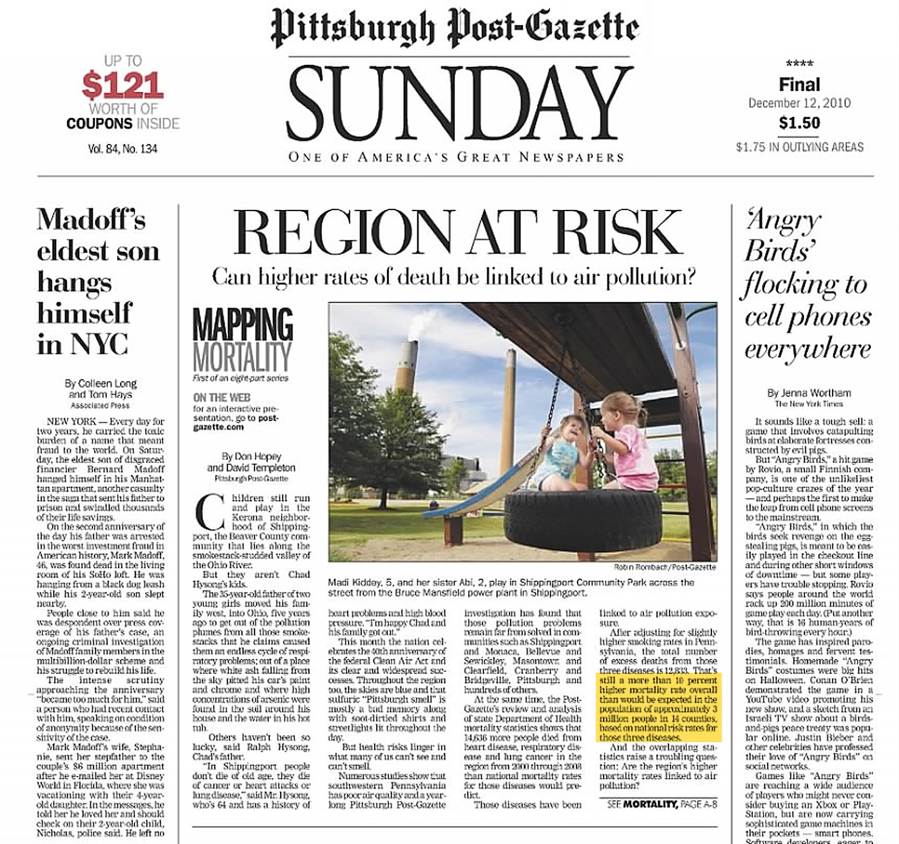
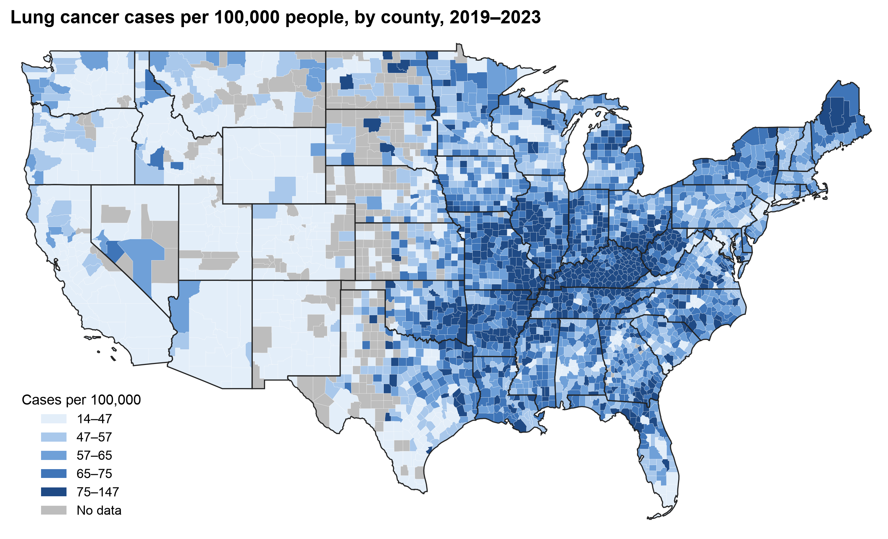
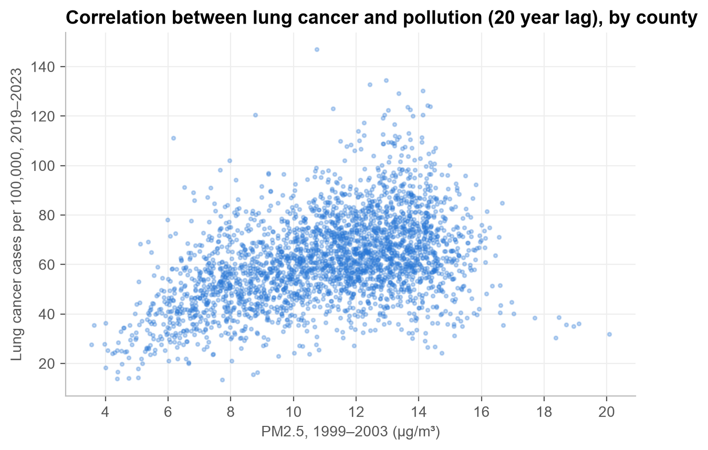
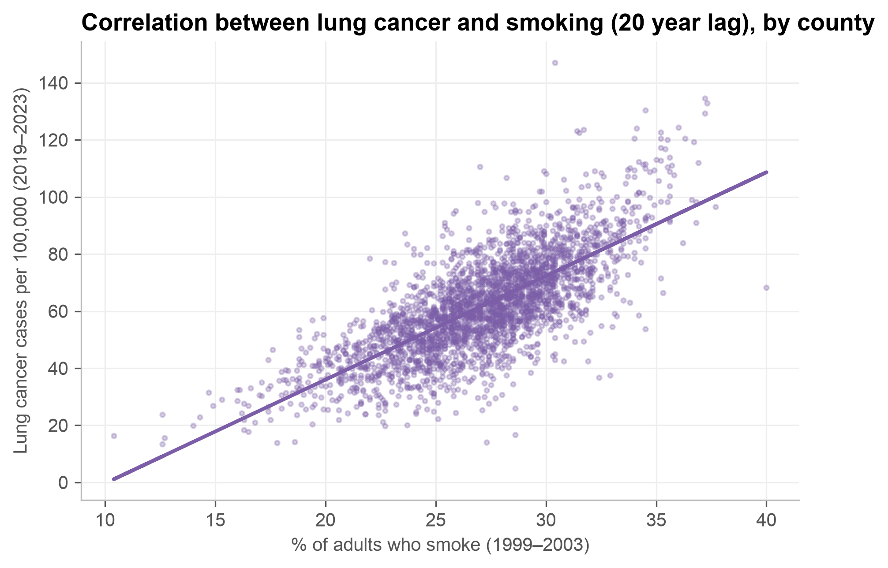
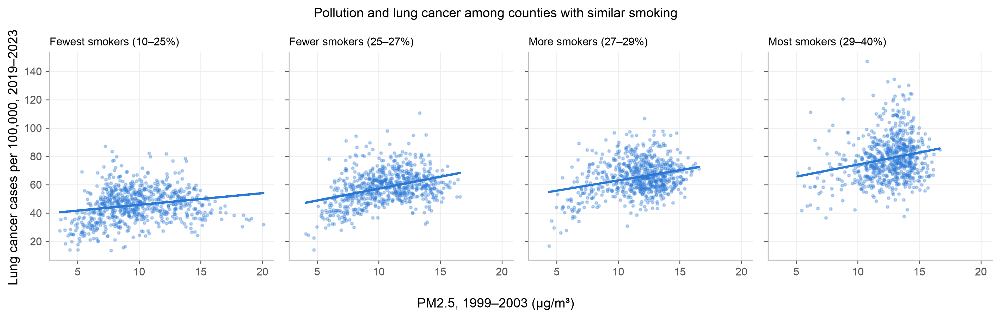
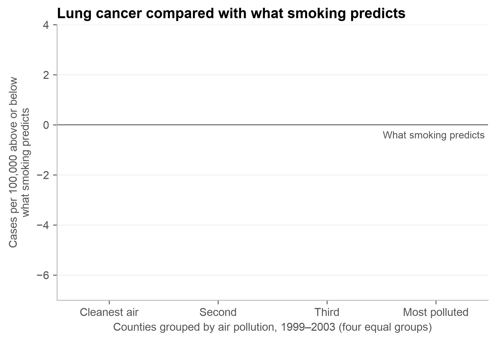
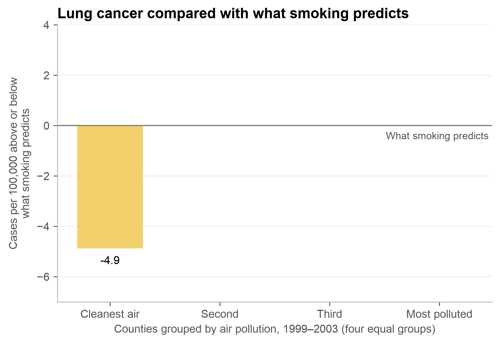
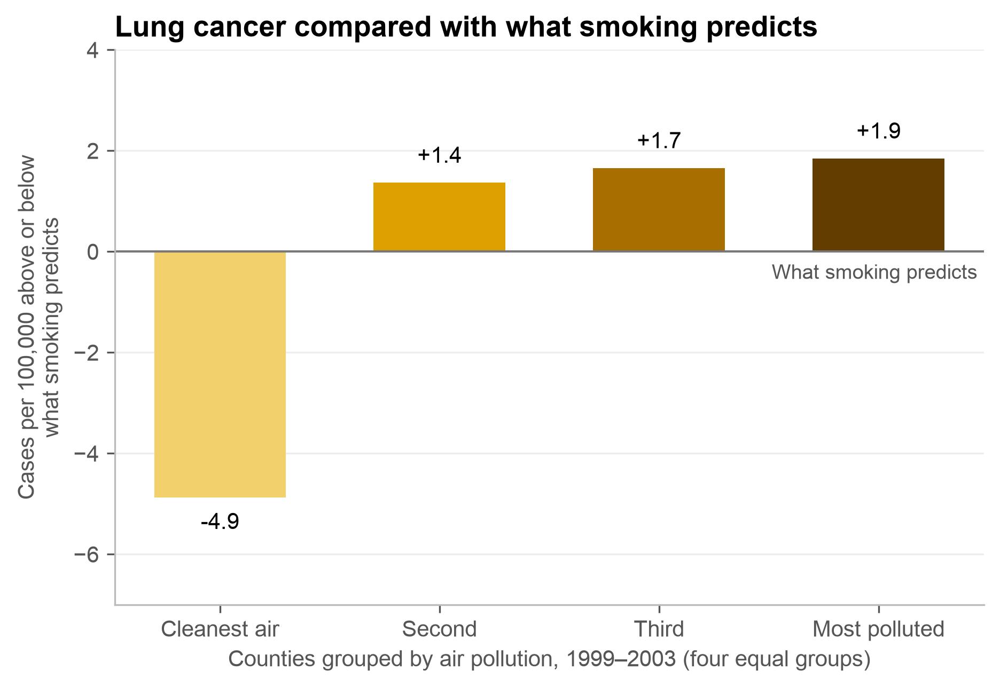

```{=html}

<style>
  /* Fonts: Source Serif 4 for reading, Libre Franklin for headings */
  @import url('https://fonts.googleapis.com/css2?family=Libre+Franklin:wght@400;600;800&family=Source+Serif+4:opsz,wght@8..60,400;8..60,600&display=swap');
  body, p, .narrative { font-family: 'Source Serif 4', Georgia, serif; }
  h1, h2, h3, .big-title h1 { font-family: 'Libre Franklin', Arial, sans-serif; }

    /* Opening: a quiet, centered portrait with the story's first lines beneath it */
  .opening { max-width: 860px; margin: 14vh auto 0; display: flow-root; }
  .opening-photo { float: right; width: 42%; margin: 0.3rem 0 1rem 2.5rem; animation: fade-up 1.4s ease-out both; }
  .opening-photo img { width: 100%; box-shadow: 0 8px 24px rgba(0, 0, 0, 0.18); }
  .opening-photo figcaption { font-family: 'Libre Franklin', Arial, sans-serif; font-size: 0.85rem; color: #777; margin-top: 0.5rem; }
  .opening-text { margin-top: 0; }
  @media (max-width: 768px) { .opening-photo { float: none; width: 100%; margin: 0 0 2rem 0; } }
  .opening-text p { font-size: 1.3rem; line-height: 1.6; margin-bottom: 1em; }
  .opening-text p:first-child::first-letter { float: left; font-family: 'Libre Franklin', Arial, sans-serif; font-weight: 800; font-size: 3.6em; line-height: 0.85; padding: 0.06em 0.1em 0 0; }
  @keyframes fade-up { from { opacity: 0; transform: translateY(16px); } to { opacity: 1; transform: none; } }

  /* Title */
  /* Title: big, tight spacing, and the smoke effect */
  .big-title h1, h1.big-title { font-size: 15.5vw; line-height: 0.9; font-weight: 800; letter-spacing: -0.03em; text-align: center; grid-column: screen-start / screen-end; margin-top: 18vh; margin-bottom: 1.5rem; }
  .big-title h1 .smoke-word:first-child { display: block; }
  .smoke-word { display: inline-block; white-space: nowrap; }
  .smoke-letter { display: inline-block; opacity: 0; filter: blur(14px); transform: translateY(0.3em) scale(1.15); }
  .materialize .smoke-letter { animation: smoke-in 1.4s ease-out forwards; }
  @keyframes smoke-in {
    0%   { opacity: 0;   filter: blur(14px); transform: translateY(0.3em) scale(1.15); }
    60%  { opacity: 0.7; filter: blur(3px); }
    100% { opacity: 1;   filter: blur(0);    transform: none; }
  }
  @media (prefers-reduced-motion: reduce) {
    .smoke-letter { opacity: 1; filter: none; transform: none; }
    .materialize .smoke-letter { animation: none; }
  }
  .dek { font-family: 'Source Serif 4', Georgia, serif; font-size: 1.4rem; line-height: 1.45; color: #444; text-align: center; max-width: none; white-space: nowrap; margin: 0 auto 1rem; grid-column: page-start / page-end; }
  @media (max-width: 768px) { .dek { white-space: normal; } }
  .byline { font-family: 'Libre Franklin', Arial, sans-serif; font-size: 0.85rem; letter-spacing: 0.05em; text-transform: uppercase; color: #777; text-align: center; margin-bottom: 8vh; }

  /* Section headings between parts of the story */
  .section-head h2, h2.section-head { font-family: 'Libre Franklin', Arial, sans-serif; font-size: clamp(1.6rem, 3vw, 2.4rem); font-weight: 800; line-height: 1.15; letter-spacing: -0.01em; text-align: left; grid-column: page-start / page-end; max-width: 900px; margin: 12vh 0 6vh 0; position: relative; z-index: 5; border-bottom: none; }

  /* Story paragraphs in the scrolling sections */
  .cr-section:not(.intro) .narrative-col .trigger { padding-block: 1.5svh; }
  .cr-section:not(.intro) .narrative { font-size: 1.2rem; line-height: 1.55; }
  .cr-section:not(.intro) .sticky img { width: 100% !important; }
  .cr-section .sticky-col .sticky-col-stack .sticky:not(.cr-active) { transform: none !important; }
  .cr-section:not(.intro) .narrative-col .trigger:last-child { padding-bottom: 3svh; }
  /* Scatterplot zooms happen inside a fixed frame */
   .cr-section .sticky-col .sticky-col-stack .sticky.zoom-frame { overflow: hidden; transform: none !important; transition: opacity 2.0s ease-in-out; }
  .zoom-frame img { transition: transform 2.0s cubic-bezier(0.45, 0, 0.25, 1); transform-origin: center center; }

    /* Pittsburgh section: pale amber panel behind the photos only */
  .cr-section.pgh { margin-block: 6vh 0; }
  .cr-section.pgh .sticky-col { background-color: #FAEEC2; padding-inline: 4vw; }
  .cr-section.pgh .narrative-col .trigger { padding-block: 3svh; }
  .cr-section.pgh .narrative-col .trigger:last-child { padding-bottom: 3svh; }
  .cr-section.pgh .sticky { box-shadow: 0 8px 24px rgba(0, 0, 0, 0.18); }
  /* Pittsburgh photos: every photo fills the same 3:2 frame */
  [id^="cr-pgh"] { width: 100%; aspect-ratio: 3 / 2; overflow: hidden; }
  [id^="cr-pgh"] p, [id^="cr-pgh"] figure, [id^="cr-pgh"] .quarto-figure { height: 100%; margin: 0; }
  [id^="cr-pgh"] img { width: 100% !important; height: 100% !important; object-fit: cover; }

  /* Pittsburgh photos: larger, each placed beside its own paragraph, fading in one at a time */
  .cr-section.pgh .sticky-col .sticky-col-stack { position: relative !important; top: auto !important; height: 100% !important; display: block !important; }
  .cr-section.pgh .sticky-col .sticky-col-stack .sticky[id^="cr-pgh"] { position: absolute !important; left: 6%; width: 88% !important; margin: 0 !important; transform: translateY(24px) rotate(var(--r)) !important; transition: opacity 1.2s ease-in-out, transform 1.2s ease-in-out !important; }
  .cr-section.pgh .sticky-col .sticky-col-stack .sticky[id^="cr-pgh"].cr-active,
  .cr-section.pgh .sticky-col .sticky-col-stack .sticky[id^="cr-pgh"].past { transform: translateY(0) rotate(var(--r)) !important; }
  .cr-section.pgh .sticky-col .sticky-col-stack .sticky[id^="cr-pgh"].past { opacity: 0; }
  #cr-pgh1 { --r: -1.5deg; }
  #cr-pgh2 { --r: 1deg; }
  #cr-pgh3 { --r: -1deg; }
  #cr-pgh4 { --r: 1.5deg; }

  /* Plain text between scrolling sections */
  .wide-text p { font-size: 1.2rem; line-height: 1.6; margin-bottom: 1em; }
  .two-col { column-count: 2; column-gap: 3rem; }
  .two-col p { break-inside: avoid; }
  @media (max-width: 768px) { .two-col { column-count: 1; } }

  /* Newspaper article */
  #cr-article, #cr-excerpt { width: 100%; }
  #cr-article img, #cr-excerpt img { width: 100% !important; }

  /* Newspaper section: article starts level with the first paragraph; zoom happens slowly inside the frame */
  .cr-section.news .sticky-col .sticky-col-stack { position: relative !important; top: auto !important; height: 100% !important; display: block !important; }
  .cr-section.news .sticky-col .sticky-col-stack #cr-article { position: absolute !important; left: 0; width: 100% !important; margin: 0 !important; overflow: hidden; transform: none !important; transition: opacity 0.8s ease-in-out !important; }
  .cr-section.news #cr-article img { transition: transform 2.2s cubic-bezier(0.45, 0, 0.25, 1) !important; transform-origin: center center; }

  /* Map toggle */
  .map-toggle { width: 100%; }
  .map-buttons { display: flex; gap: 0.5rem; justify-content: center; margin-bottom: 0.75rem; }
  .map-buttons button { font-family: 'Libre Franklin', Arial, sans-serif; font-size: 0.9rem; font-weight: 600; padding: 0.45rem 1rem; border-radius: 999px; border: 1.5px solid #BBBBBB; background: white; color: #555555; cursor: pointer; transition: all 0.3s ease; }
  .map-buttons button[data-map="pollution"].active { background: #B97F00; border-color: #B97F00; color: white; }
  .map-buttons button[data-map="cancer"].active { background: #3F75B8; border-color: #3F75B8; color: white; }
  .map-stack { display: grid; }
  .map-stack img { grid-area: 1 / 1; width: 100%; opacity: 0; transition: opacity 0.6s ease-in-out; }
  .map-stack img.active { opacity: 1; }

  /* Map section: text on the left, map panel on the right that travels with the text */
  .map-section { display: grid; grid-template-columns: 1fr 1.4fr; gap: 3rem; align-items: start; margin: 4vh auto 0; }
  .map-section .map-text p { font-size: 1.2rem; line-height: 1.55; margin-bottom: 1.1em; }
  .map-section .map-text p:last-child, .wide-text p:last-child { margin-bottom: 0; }   /* no extra space after the last paragraph of a section */
  .map-section .map-panel { position: sticky; top: 10vh; }
  @media (max-width: 768px) { .map-section { grid-template-columns: 1fr; } .map-section .map-panel { position: static; } }


  /* Scatterplot zoom frame: both images stacked, zooming together inside a fixed box */
  .zoom-box { display: grid; overflow: hidden; }
  .zoom-box img { grid-area: 1 / 1; width: 100%; transform-origin: center center; transition: transform 1.6s cubic-bezier(0.45, 0, 0.25, 1), opacity 1.2s ease-in-out; }
  .zoom-box img.scatter-line { opacity: 0; }
  .zoom-box img.scatter-line.active { opacity: 1; }
  @media (prefers-reduced-motion: reduce) { .zoom-box img { transition: opacity 0.4s ease-in-out; } }

  /* Swap panel: charts stacked in one spot, crossfading when the text cues them */
  .swap-panel { display: grid; align-items: center; }
  .swap-panel img { grid-area: 1 / 1; width: 100%; opacity: 0; transition: opacity 0.8s ease-in-out; }
  .swap-panel img.active { opacity: 1; }

  /* Same side margins for every section: scrolling sections line up with the rest of the page */
  .cr-section.cr-column-screen:not(.intro) { grid-column: page-start / page-end !important; }
  .cr-section .narrative-col .trigger { padding-inline: 0 2rem; }
  .cr-section .narrative-col .trigger .narrative { padding-left: 0; }

</style>

<script>
document.addEventListener("DOMContentLoaded", function () {
  const title = document.querySelector("h1.big-title, .big-title h1");
  if (!title) return;

  // Wrap each letter in its own span so the letters can appear one at a time
  const words = title.textContent.trim().split(" ");
  title.innerHTML = "";
  let n = 0;
  words.forEach(function (word, w) {
    const wordSpan = document.createElement("span");
    wordSpan.className = "smoke-word";
    for (const letter of word) {
      const s = document.createElement("span");
      s.className = "smoke-letter";
      s.textContent = letter;
      s.style.animationDelay = (n * 0.07) + "s";   // each letter starts 0.07 seconds after the one before
      wordSpan.appendChild(s);
      n++;
    }
    title.appendChild(wordSpan);
    if (w < words.length - 1) title.appendChild(document.createTextNode(" "));
  });

  // Start the animation when the title scrolls into view
  new IntersectionObserver(function (entries, observer) {
    if (entries[0].isIntersecting) {
      title.classList.add("materialize");
      observer.disconnect();
    }
  }, { threshold: 0.4 }).observe(title);
});

// Zoom inside a fixed frame: move Closeread's zoom from the frame onto the image inside it.
// When a new image appears, it starts at the previous image's zoom, so the switch looks seamless.
document.addEventListener("DOMContentLoaded", function () {
  let lastZoom = "none";   // the zoom of whichever image was showing most recently
  document.querySelectorAll(".zoom-frame").forEach(function (frame) {
    const img = frame.querySelector("img");
    if (!img) return;
    let wasActive = false;
    function copyZoom() {
      const isActive = frame.classList.contains("cr-active");
      const target = frame.style.transform || "none";
      if (isActive && !wasActive) {
        // Just appeared: jump (invisibly) to the previous zoom, then animate to this step's zoom
        img.style.transition = "none";
        img.style.transform = lastZoom;
        void img.offsetWidth;            // makes the browser register the starting point
        img.style.transition = "";
      }
      img.style.transform = isActive ? target : "none";
      if (isActive) lastZoom = target;
      wasActive = isActive;
    }
    new MutationObserver(copyZoom).observe(frame, { attributes: true, attributeFilter: ["style", "class"] });
  });
});


// Map toggle: buttons switch between maps, and scroll cues switch them automatically
document.addEventListener("DOMContentLoaded", function () {
  const toggle = document.querySelector(".map-toggle");
  if (!toggle) return;

  function showMap(name) {
    toggle.querySelectorAll("[data-map]").forEach(function (el) {
      el.classList.toggle("active", el.dataset.map === name);
    });
  }

  toggle.querySelectorAll("button").forEach(function (button) {
    button.addEventListener("click", function () { showMap(button.dataset.map); });
  });

  document.querySelectorAll(".map-cue").forEach(function (cue) {
    new IntersectionObserver(function (entries) {
      if (entries[0].isIntersecting) showMap(cue.dataset.map);
    }, { rootMargin: "-50% 0px -50% 0px" }).observe(cue.parentElement);
  });
});

// Scatterplot zoom: cues in the text set the view inside a fixed frame
document.addEventListener("DOMContentLoaded", function () {
  const box = document.querySelector(".zoom-box");
  if (!box) return;
  const images = box.querySelectorAll("img");
  const lineImage = box.querySelector(".scatter-line");

  // Each view: how far to zoom (scale) and which way to slide (translate)
  const views = {
    full:      "none",
    lowerleft: "translate(30%, -30%) scale(1.6)",
    right:     "translate(-22%, 5%) scale(1.6)",
    line:      "none"
  };

  function showView(name) {
    images.forEach(function (img) { img.style.transform = views[name]; });   // both images move together
    lineImage.classList.toggle("active", name === "line");                    // line appears only in the last step
  }

  document.querySelectorAll(".zoom-cue").forEach(function (cue) {
    new IntersectionObserver(function (entries) {
      if (entries[0].isIntersecting) showView(cue.dataset.view);
    }, { rootMargin: "-50% 0px -50% 0px" }).observe(cue.parentElement);
  });
});

// Swap panels: cues in the text switch which chart is showing in the same section
document.addEventListener("DOMContentLoaded", function () {
  document.querySelectorAll(".map-section").forEach(function (section) {
    const panel = section.querySelector(".swap-panel");
    if (!panel) return;
    function show(name) {
      panel.querySelectorAll("img").forEach(function (img) {
        img.classList.toggle("active", img.dataset.show === name);
      });
    }
    section.querySelectorAll(".swap-cue").forEach(function (cue) {
      new IntersectionObserver(function (entries) {
        if (entries[0].isIntersecting) show(cue.dataset.show);
      }, { rootMargin: "-50% 0px -50% 0px" }).observe(cue.parentElement);
    });
  });
});

// Pittsburgh photos: mark photos that came earlier as "past" so they stay visible, faded, in the stack
document.addEventListener("DOMContentLoaded", function () {
  const photos = Array.from(document.querySelectorAll(".cr-section.pgh .sticky"));
  if (!photos.length) return;
  function update() {
    const current = photos.findIndex(function (p) { return p.classList.contains("cr-active"); });
    photos.forEach(function (p, i) { p.classList.toggle("past", current > -1 && i < current); });
  }
  photos.forEach(function (p) {
    new MutationObserver(update).observe(p, { attributes: true, attributeFilter: ["class"] });
  });
});

// Pittsburgh photos: place each photo beside its own paragraph, inside the yellow panel
function placePittsburghPhotos() {
  const section = document.querySelector(".cr-section.pgh");
  if (!section) return;
  const panel = section.querySelector(".sticky-col");
  const paragraphs = section.querySelectorAll(".narrative-col .trigger p");
  const photos = section.querySelectorAll(".sticky");
  const panelTop = panel.getBoundingClientRect().top;
  photos.forEach(function (photo, i) {
    if (!paragraphs[i]) return;
    const paragraphTop = paragraphs[i].getBoundingClientRect().top - panelTop;
    const lowest = panel.offsetHeight - photo.offsetHeight - 24;      // keep a 24px margin at the bottom of the panel
    photo.style.top = Math.min(Math.max(paragraphTop, 24), lowest) + "px";
  });
}
window.addEventListener("load", placePittsburghPhotos);
window.addEventListener("resize", placePittsburghPhotos);

// Newspaper section: line up the top of the article with the top of the first paragraph
function placeArticle() {
  const article = document.querySelector("#cr-article");
  if (!article) return;
  const section = article.closest(".cr-section");
  const panel = section.querySelector(".sticky-col");
  const firstParagraph = section.querySelector(".narrative-col .trigger p");
  article.style.top = (firstParagraph.getBoundingClientRect().top - panel.getBoundingClientRect().top) + "px";
  panel.style.minHeight = (article.offsetTop + article.offsetHeight) + "px";   // make the section tall enough to hold the whole article
}
window.addEventListener("load", placeArticle);
window.addEventListener("resize", placeArticle);

</script>

```

:::{.opening}

:::{.opening-photo}
{fig-alt="Photo of Barney and Susie Guttman"}
:::

:::{.opening-text}

My parents were both diagnosed with lung cancer in their 80s.

My mother's surgery was successful. My father's treatment protocol - immunotherapy, chemotherapy, and radiation - was not. He died nine months after his initial diagnosis.

Strangely, several of their friends were diagnosed with lung cancer around the same time. Was there a common denominator? They were all born and raised in Pittsburgh, starting in the 1940s, and had all led seemingly healthy lives. None were smokers.

:::

:::

# Something in the Air {.unnumbered .big-title}

:::{.dek}
I went looking for cancer clues in the skies above Pittsburgh.
:::

:::{.byline}
By Harley Ungar · December 2026
:::

:::{.cr-section .pgh .cr-column-screen}

For more than a century, Pittsburgh was known as the Smoky City. Coal-fired mills, railroads and home furnaces filled the air so thickly that streetlights burned at midday. @cr-pgh1

That began to change after World War II. A smoke-control law passed in 1941 and was finally enforced in 1946. Within a decade, visible smoke had dropped dramatically.  @cr-pgh2

A quarter century later, the steel industry collapsed. Between the late 1970s and mid-1980s, the region lost tens of thousands of mill jobs, a devastating blow to the economy, though one that further cleared the air. @cr-pgh3

By the early 1990s, Pittsburgh’s skies looked much cleaner. But the fine-particle pollution you can’t see took longer to clear. When the CDC began tracking PM2.5 around 2000, Pittsburgh’s levels were still among the highest in the country. By then, many of the city’s older residents had been breathing polluted air for decades. @cr-pgh4

:::{#cr-pgh1}

:::

:::{#cr-pgh2}

:::

:::{#cr-pgh3}

:::

:::{#cr-pgh4}

:::

:::

## I wasn't the first person to wonder about the pollution–cancer connection. {.section-head .unnumbered}

:::{.cr-section .news}

In December 2010, the Pittsburgh Post-Gazette ran an eight-part series called "Mapping Mortality: A Special Report on the Air We Breathe." Reporters Don Hopey and David Templeton spent a year analyzing 2000–2008 death rates from heart disease, lung disease and lung cancer across 14 counties in western Pennsylvania. @cr-article

With the help of local statisticians and public health experts, they concluded that cancer and heart disease rates in the Pittsburgh area were "more than 16 percent higher" than national rates would predict. [@cr-article]{scale-by="2" pan-to="-47%,-50%"}

:::{#cr-article .zoom-frame}

:::

:::

## Fifteen years after the newspaper's acclaimed series, I decided to revisit the analysis. {.section-head .unnumbered}

:::{.wide-text .two-col .column-page}

Rather than narrowly retracing Hopey and Templeton's journalistic steps, I chose to widen the lens. Instead of studying 14 counties in western Pennsylvania, I wanted to look at the entire country.

First, I needed to know where lung cancer strikes most often today. The National Cancer Institute and the CDC track new cases in nearly every county in America. I pulled their numbers for 2019 to 2023, looking at how many people out of every 100,000 were diagnosed each year. I came up with a recent, annual, normalized average for each county in the U.S.

Then came the air measurementss. Lung cancer doesn't appear overnight; it can take decades to develop. So rather than looking at today's air quality, I went back 20 years. Using estimates from the Center for Air, Climate, and Energy Solutions (CACES), I found out how much fine-particle pollution, known as PM2.5, residents of each county were breathing between 1999 and 2003. That became my annual average measure of air quality. CACES only covers the continental U.S. (excluding Alaska and Hawaii), so I was able to obtain data for 3,109 counties.

:::

<!-- SAVED FOR LATER: cancer and pollution maps
:::{#cr-cancermap}

:::

:::{#cr-pollutionmap}

:::
-->

## So, were air pollution and lung cancer positively correlated? {.section-head .unnumbered}

:::{.map-section .column-page}

:::{.map-text}

[]{.zoom-cue data-view="full"}Based on the data, I created a scatterplot placing each of the roughly 3,000 counties by two measures: its average PM2.5 concentration from 1999 to 2003 on the horizontal axis, and its age-adjusted lung cancer rate from 2019 to 2023 on the vertical axis.

[]{.zoom-cue data-view="lowerleft"}Starting in the lower left quadrant, counties with the cleanest air around 2000 mostly have low lung cancer rates today.

[]{.zoom-cue data-view="right"}As you move towards counties with higher air pollution, you'll see that the cancer rates also rise. In short, counties with dirtier air tend to have higher cancer rates.

[]{.zoom-cue data-view="line"}A best-fit line traces that upward drift, the signature of a positive correlation. How strong is the link? The correlation coefficient (r) is 0.43, on a scale where 0 means no relationship and 1 means a perfect one. That's a moderate correlation: real, but far from airtight.

:::

:::{.map-panel}
```{=html}
<div class="zoom-box">
  
  
</div>
```
:::

:::

## Where in the country do pollution and cancer closely overlap? {.section-head .unnumbered}

:::{.map-section .column-page}

:::{.map-text}

[]{.map-cue data-map="pollution"}The scatterplot shows that pollution and lung cancer generally rise together, but not where the overlap is most pronounced. To visualize the geography of the correlation, I mapped each measure on its own, using a five-step scale: each shade holds one-fifth of all counties, from lowest to highest.

The first map, in amber, shows the intensity of air pollution around 2000 in all U.S. counties.

[]{.map-cue data-map="cancer"}The second map, in blue, shows lung cancer prevalence in various counties today.

By using the buttons above the map, you can switch back and forth between the two.

On both maps, the same region stands out. A band of counties running from Ohio and Indiana down through Kentucky, Tennessee and West Virginia had some of the dirtiest air in the country around 2000, and it has some of the highest lung cancer rates today. This is the heart of the old industrial Midwest and Appalachia, the same kind of coal-and-steel country as the Pittsburgh my parents grew up in.

However, the overlap between the two maps is far from perfect. Southern California had the most polluted air in the nation, yet its lung cancer rates are among the lowest. Maine and parts of the rural South and Midwest show the inverse: relatively clean air, but high rates of lung cancer.

Those mismatches are a clue. If pollution alone drove lung cancer, the two maps would look nearly identical. Something else is shaping the pattern, and for lung cancer, the most obvious suspect is...  smoking.

:::

:::{.map-panel}
```{=html}
<div class="map-toggle">
  <div class="map-buttons">
    <button data-map="pollution" class="active">Air pollution, 1999–2003</button>
    <button data-map="cancer">Lung cancer, 2019–2023</button>
  </div>
  <div class="map-stack">
    
    
  </div>
</div>
```
:::

:::

## Two kinds of smoke {.section-head .unnumbered}

:::{.map-section .column-page}

:::{.map-text}

[]{.swap-cue data-show="scatter"}My parents never smoked. That's part of why I suspected the air. But across the country, cigarettes, not smokestacks, are the leading cause of lung cancer: smoking is linked to [roughly 80 to 90 percent](https://www.cdc.gov/lung-cancer/risk-factors/index.html) of lung cancer deaths.

So I added a third measure: the share of adults who smoked in each county between 1999 and 2003, the same window as the pollution data, based on estimates from the Institute for Health Metrics and Evaluation (IHME).

The relationship is far stronger. Smoking and lung cancer have a correlation of 0.74, compared with 0.43 for pollution. Smoking alone accounts for more than half of the differences in cancer rates between counties (R² = 0.55), roughly three times as much as pollution (R² = 0.18).

Interestingly, the two kinds of smoke tend to turn up in the same places. Counties with dirtier air also tended to have more smokers (r = 0.36).

That raises an uncomfortable possibility: some of what looked like a pollution pattern may really be a smoking pattern. To find out whether dirty air matters on its own, factoring out the impact of smoking, I needed to compare counties whose smoking rates were alike.

:::

:::{.map-panel}
```{=html}
<div class="swap-panel">
  
</div>
```
:::

:::

## Holding smoking steady {.section-head .unnumbered}

:::{.wide-text .column-page}

To separate the two kinds of smoke, I sorted counties into four equal groups by smoking rate, from the lightest-smoking quarter (10 to 25 percent of adults who smoke) to the heaviest (29 to 40 percent who smoke). Within each group, smoking is roughly the same, so if pollution still tracks lung cancer there, smoking can't be the whole explanation.

:::

:::{.column-page}
{fig-alt="Four scatterplots of air pollution against lung cancer, one for each quarter of counties by smoking rate. In every panel, the best-fit line slopes gently upward."}
:::

:::{.wide-text .column-page}

Holding smoking steady cuts the pollution effect roughly in half. Across all counties, each additional microgram of PM2.5 per cubic meter was associated with 2.8 more lung cancer cases per 100,000 people. Within the smoking groups, that figure falls to between 0.8 and 1.7, and the correlations drop from 0.43 to between 0.20 and 0.36.

But the effect doesn't disappear. In every one of the four groups, the line still slopes upward: even among counties that smoked at similar rates, the ones that suffered from more polluted air have more lung cancer today.

:::

## Beyond smoking, does the air still matter? {.section-head .unnumbered}

:::{.map-section .column-page}

:::{.map-text}

[]{.swap-cue data-show="step1"}There is one more way to look at the impact of air pollution in isolation. Using each county's smoking rate, I estimated how much lung cancer it *should* have if smoking were the only factor. Then I compared that estimate with what actually happened. The line across this chart marks "exactly what smoking predicts."

Next, I sorted counties into four equal groups by how polluted their air was around 2000, from lightest to darkest amber, and averaged how far each group landed above or below its predicted lung cancer rate based only on smoking rates.

[]{.swap-cue data-show="step2"}Counties with the cleanest air came in about 5 cases per 100,000 below what their smoking would predict.

[]{.swap-cue data-show="step3"}Everywhere else, lung cancer rates ran slightly above the prediction, increasing (albeit not significantly) as air pollution rates increased. 

Clean air seems to protect, and dirtier air seems to increase the risk of lung cancer. But past a certain point, dirtier air adds surprisingly little that this data can detect.

:::

:::{.map-panel}
```{=html}
<div class="swap-panel">
  
  
  
</div>
```
:::

:::

## Losing the Blame Game {.section-head .unnumbered}

:::{.wide-text .column-body}

I started this project hoping the data would prove what I already suspected: that the smoke my parents breathed as children in Pittsburgh had caught up with them decades later.

It didn't. Around 2000, Allegheny County's air was dirtier than that of 98 percent of U.S. counties. Yet its lung cancer rate today is ordinary, and slightly *lower* than its smoking rate alone would predict. The same is true for 12 of the 14 western Pennsylvania counties the Post-Gazette studied in 2010.

That doesn't mean the air was harmless. Across the country, counties with the cleanest air have less lung cancer than their smoking would predict, and even among counties that smoked at similar rates, dirtier air goes with somewhat more cancer. Pollution matters. It just matters far less than cigarettes, and less than I expected.

And county data can't answer the question that started all of this. It counts the people who live in a county today, not the people who grew up there. When the mills closed, hundreds of thousands of people left the Pittsburgh area, and if they later developed lung cancer, it was counted somewhere else. The pollution data also begins in 1999, long after the smokiest decades my parents lived through. And averages describe places, not people. No map can tell me why my father got sick.

I really wanted to blame Pittsburgh's industrial past for my father's death. But apparently, it's more complicated than that.

:::